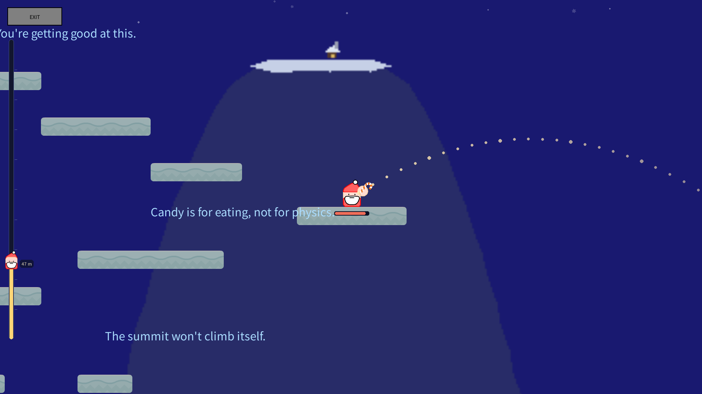
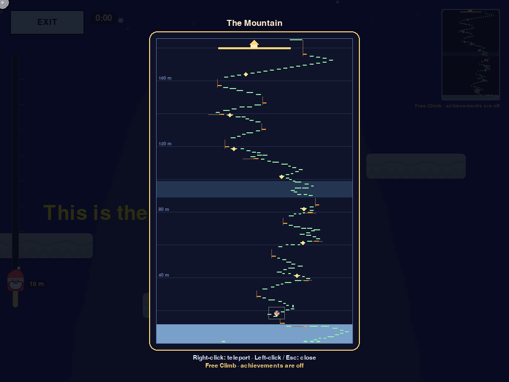
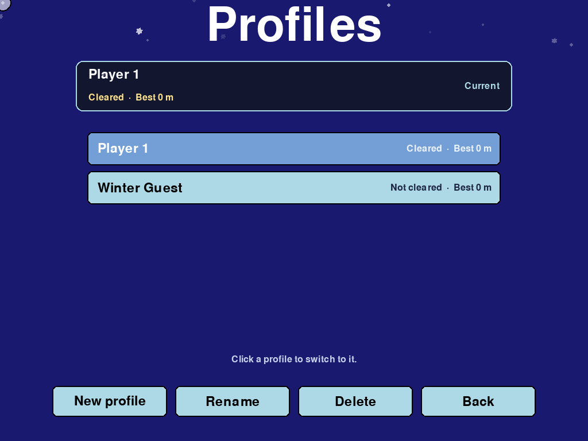
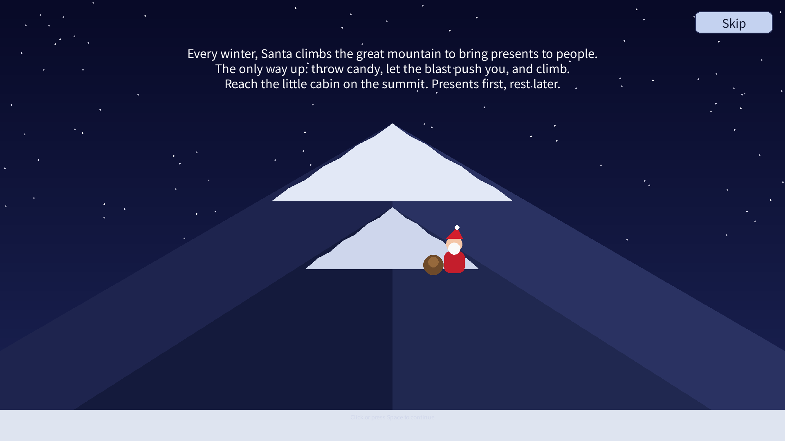

# A SLIPERY CLIMB

**A small, slippery climbing game about a Santa who has to get up a very big
mountain to deliver presents.**

There is no walk button. You move by throwing candy and letting the explosions
push you around: throw backwards to slide forwards, blast-jump over gaps, and
ride the moving platforms up the mountain.

### [⬇ Download the latest release](../../releases/latest)

**1.5.0 “SUMMIT” — the first official release.**

## Features

- Hand-made level in the spirit of *Getting Over It*: stairs, steep ladders,
  drop jumps, ferries, elevators, curved moving platforms and a windy ridge
- Candy-bomb movement: throw, blast, slide, climb
- Dotted trajectory preview while aiming: see where the candy will fly
- **Easy mode with 8 checkpoints** (picked per new save) or the classic normal
  mode
- **Free Climb** — clear the mountain once in Regular mode and the whole
  climb becomes a sandbox: a map of the entire mountain, right-click to teleport anywhere,
  achievements off, no saving
- **Profiles** — several players on one computer, each with their own saves,
  achievements, "cleared" status and Free Climb unlock
- **Update prompt** — the menu tells you when a newer release exists and opens
  the download page (GitHub Releases only; nothing is sent)
- **Run timer** next to the Exit button, frozen on the victory screen
- **Full voice-over in 9 languages** for idle chatter and fall taunts, with
  separate sound, music and voice volume sliders
- **Fullscreen or windowed** display, with menus that scale to the window
- 9 languages: English, русский, 中文, 日本語, 한국어, Deutsch, Français,
  Italiano, Español (fonts included)
- Intro and victory cutscenes (skippable), idle chatter on the way up
- Leveled achievements, 5 save slots per profile
- Clearing the mountain deletes that save slot, so every run starts fresh
- Asking before quitting — no accidental Alt+F4

## Controls

| Input | Action |
|---|---|
| Mouse | aim and throw candy |
| Alt | toggle the cursor while playing |
| Esc | save and return to the menu |
| Space / Enter | skip cutscene |
| M | open / close the Free Climb map (Free Climb only) |
| Right click on the map | teleport there (Free Climb only) |

## Download

| OS | File | What to do |
|---|---|---|
| **Windows** | [ASliperyClimb_Windows.zip](../../releases/latest/download/ASliperyClimb_Windows.zip) | unpack, run `A Slipery Climb.exe` |
| **macOS** | [ASliperyClimb_macOS.zip](../../releases/latest/download/ASliperyClimb_macOS.zip) | unpack, open `A Slipery Climb.app` |
| **Linux** (any distro) | [ASliperyClimb_Linux.tar.gz](../../releases/latest/download/ASliperyClimb_Linux.tar.gz) | unpack, run `A Slipery Climb/A Slipery Climb` |
| **Linux** (deb) | [ASliperyClimb_Linux_amd64.deb](../../releases/latest/download/ASliperyClimb_Linux_amd64.deb) | `sudo apt install ./ASliperyClimb_Linux_amd64.deb` |
| **Linux** (rpm) | [ASliperyClimb_Linux_x86_64.rpm](../../releases/latest/download/ASliperyClimb_Linux_x86_64.rpm) | `sudo dnf install ./ASliperyClimb_Linux_x86_64.rpm` |

No Python or pygame installation is needed: the builds are self-contained.

If GitHub is slow in your country, use a mirror from the
**[mirror list in the 中文 section](#中文)** (Gitee / 蓝奏云). The files are the same.

Throttled downloads hang around 100 KB/s and can stop at the end - if that
happens, use a mirror instead of retrying GitHub.

> **macOS:** the current macOS build is for Apple Silicon (M1/M2/M3 and newer);
> Intel Macs are not supported by that build yet.

Verify your download with `SHA256SUMS.txt` from the same release page
(`certutil -hashfile ASliperyClimb_Windows.zip SHA256` on Windows,
`sha256sum <file>` on Linux/macOS).

### First launch

- **Windows** may show *"Windows protected your PC"* (the exe is not
  code-signed). Click **More info → Run anyway**.
- **macOS** may say *"Apple cannot check it for malicious software"*. Open
  **System Settings → Privacy & Security**, scroll to *Security* and click
  **Open Anyway** (macOS 15 and newer), or run
  `xattr -dr com.apple.quarantine "A Slipery Climb.app"` once in Terminal.
  The app is not notarized.
- **Linux**: if the file is not executable, run
  `chmod +x "A Slipery Climb/A Slipery Climb"`.

## Where the game keeps its data

| OS | Folder |
|---|---|
| Windows | `%APPDATA%\A Slipery Climb` |
| macOS | `~/Library/Application Support/A Slipery Climb` |
| Linux | `~/.local/share/A Slipery Climb` |

Settings live in that folder; every profile keeps its own saves, achievements
and progress in `profiles\<id>\`. Remove the whole folder to reset everything
(settings, achievements, profiles and all saves).

## 中文

一个关于圣诞老人的小游戏：他要爬上很高的山，把礼物送到山顶的小屋。

**没有“走”这个按钮**——你只能靠扔糖果、借爆炸的反冲把自己推上去：
往后扔往前滑、往脚下扔起跳、等移动平台靠过来再搭上去。

- 手工关卡（Getting Over It 风格）：台阶、陡梯、下跳、渡船、电梯、弧线移动平台，
  还有一段会刮风的山脊
- 瞄准时显示糖果飞行轨迹（虚线预览）
- **简单模式 8 个检查点**，或经典常规模式（新建存档时选择）
- **自由攀登**：常规模式通关一次后解锁——右上角全山地图，右键传送到任意位置，
  不解锁成就、不占存档
- **账号系统**：一台电脑多个玩家，各自独立的存档、成就、通关记录
- **更新提示**：有新版本时主菜单会提示，并可直接打开下载页
  （只连 GitHub Releases，不发送任何信息）
- **计时器**：左上角显示本趟用时，登顶停表
- 9 种语言（含中文），全程配音，音效/音乐/语音音量分开调
- 全屏或窗口模式，所有界面按窗口大小自适应
- 开场 / 通关过场（可跳过）、随机闲聊、带等级的成就
- 每个账号 5 个存档位，通关会删掉该存档
- 退出游戏前会先确认

**下载**：到 [Releases](../../releases/latest) 页面按系统选：
Windows 下 `ASliperyClimb_Windows.zip`，解压后双击 `A Slipery Climb.exe`；
macOS 用 `ASliperyClimb_macOS.zip`；Linux 用 `ASliperyClimb_Linux.tar.gz`，或 `ASliperyClimb_Linux_amd64.deb` / `ASliperyClimb_Linux_x86_64.rpm`。

### 国内下载（GitHub 打不开或很慢时）

国内直连 GitHub 下载 exe 经常几十 KB/s 甚至断掉，建议用镜像。文件完全一样：

| 渠道 | 地址 | 说明 |
|---|---|---|
| GitHub（主） | [Releases 页面](../../releases/latest) | 最新版本，全球通用 |
| Gitee 镜像 | [gitee.com/hotpot9628/A-Slipery-Climb/releases](https://gitee.com/hotpot9628/A-Slipery-Climb/releases) | 国内速度快 |
| 蓝奏云 | 见 GitHub Releases 说明里的备用链接 | 网盘直链 |

- 首次启动会弹「Windows 已保护你的电脑」——这是未签名程序的正常提示，点
  **更多信息 → 仍要运行** 即可。macOS 见英文段落的说明。
- 想确认下载没被改过：用同一次发布里的 `SHA256SUMS.txt` 对比（Windows 上
  `certutil -hashfile 文件名 SHA256`）。
- 如果 GitHub 下载卡住，先别反复重试，换镜像更快。

存档位置：Windows `%APPDATA%\A Slipery Climb`；macOS
`~/Library/Application Support/A Slipery Climb`；Linux `~/.local/share/A Slipery Climb`。
设置在该文件夹里，每个账号的数据在 `profiles\<id>\` 下。

## Русский

Небольшой «скользкий» платформер про Санту, которому нужно подняться на большую
гору и доставить подарки. Кнопки «идти» нет: двигаешься только бросками конфет и
взрывами.

- ручной уровень в духе Getting Over It: лестницы, прыжки вниз, паромы, лифты
  и ветреный гребень; при прицеливании видно траекторию конфеты
- **Лёгкий режим с 8 контрольными точками** или классический обычный режим
- **Свободный подъём**: после первого прохождения в обычном режиме — карта всей горы и телепорт
  правым кликом, достижения отключены, сохранений нет
- **Проверка обновлений**: меню сообщает о новой версии и открывает страницу
  загрузки (только GitHub Releases, ничего не отправляется)
- **Профили**: несколько игроков на одном компьютере, у каждого свои сохранения,
  достижения и прогресс
- **Таймер**: время забега рядом с кнопкой выхода, останавливается на вершине
- 9 языков, включая русский, полная озвучка; звук, музыка и голос — отдельно
- катсцены (можно пропустить), достижения с уровнями, 5 слотов сохранения на профиль
- перед выходом игра спрашивает подтверждение

**Скачать**: на странице [Releases](../../releases/latest) — Windows
(`ASliperyClimb_Windows.zip`), macOS (`ASliperyClimb_macOS.zip`), Linux
(`ASliperyClimb_Linux.tar.gz`, `ASliperyClimb_Linux_amd64.deb`,
`ASliperyClimb_Linux_x86_64.rpm`). Установка не нужна, Python не требуется.

Если GitHub медленный, в китайском разделе выше есть зеркала (Gitee / 蓝奏云) —
файлы те же. Проверить загрузку можно через `SHA256SUMS.txt` из того же релиза.

Настройки и сохранения: Windows `%APPDATA%\A Slipery Climb`; macOS
`~/Library/Application Support/A Slipery Climb`; Linux `~/.local/share/A Slipery Climb`.
Данные профилей лежат в `profiles\<id>\`.

## Made with

Built with Python 3.8 and Pygame 2.6 so older machines can still run
it. This is a small solo project: the level is hand-built
and all art, audio and voice lines are shipped inside the download.

Building from source? See [BUILDING.md](BUILDING.md).

## License

- Game code and level design: MIT
- Art (textures) and audio (sounds): all rights reserved

See [LICENSE.txt](LICENSE.txt).

---

*The spelling "SLIPERY" is intentional.*
