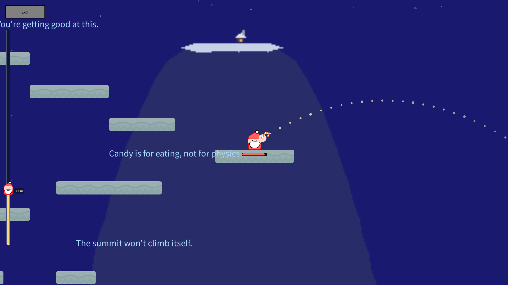
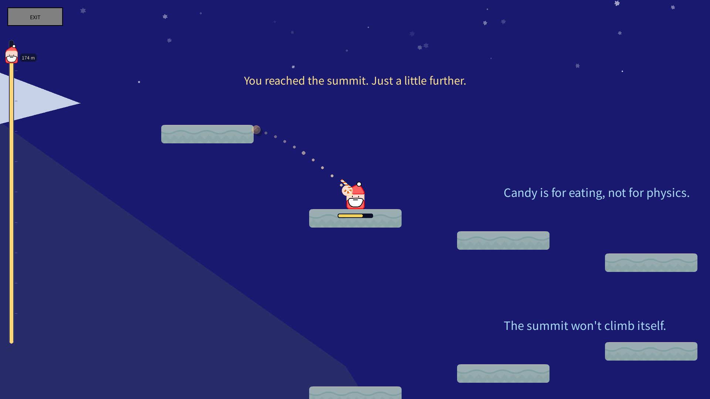
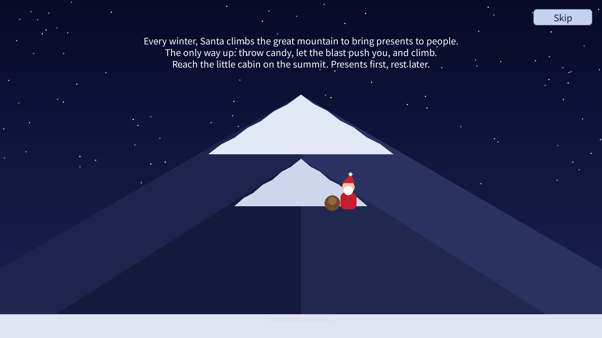

# A SLIPERY CLIMB

**A small, slippery climbing game about a Santa who has to get up a very big
mountain to deliver presents.**

There is no walk button. You move by throwing candy and letting the explosions
push you around: throw backwards to slide forwards, blast-jump over gaps, and
ride the moving platforms up the mountain.

### [⬇ Download the latest release](../../releases/latest)

## Features

- Hand-made level in the spirit of *Getting Over It*: stairs, steep ladders,
  drop jumps, ferries, elevators, curved moving platforms and a windy ridge
- Candy-bomb movement: throw, blast, slide, climb
- Dotted trajectory preview while aiming: see where the candy will fly
- 9 languages: English, русский, 中文, 日本語, 한국어, Deutsch, Français,
  Italiano, Español
- Intro and victory cutscenes (skippable), idle chatter on the way up
- Leveled achievements, 5 save slots
- Clearing the mountain deletes that save slot, so every run starts fresh

## Controls

| Input | Action |
|---|---|
| Mouse | aim and throw candy |
| Esc | save and return to the menu |
| Space / Enter | skip cutscene |

## Download

| OS | File | What to do |
|---|---|---|
| **Windows** | [ASliperyClimb_Windows.zip](../../releases/latest/download/ASliperyClimb_Windows.zip) | unpack, run `A Slipery Climb.exe` |
| **macOS** | [ASliperyClimb_macOS.zip](../../releases/latest/download/ASliperyClimb_macOS.zip) | unpack, open `A Slipery Climb.app` |
| **Linux** (any distro) | [ASliperyClimb_Linux.tar.gz](../../releases/latest/download/ASliperyClimb_Linux.tar.gz) | unpack, run `A Slipery Climb/A Slipery Climb` |
| **Linux** (deb) | [ASliperyClimb_Linux_amd64.deb](../../releases/latest/download/ASliperyClimb_Linux_amd64.deb) | `sudo apt install ./ASliperyClimb_Linux_amd64.deb` |
| **Linux** (rpm) | [ASliperyClimb_Linux_x86_64.rpm](../../releases/latest/download/ASliperyClimb_Linux_x86_64.rpm) | `sudo dnf install ./ASliperyClimb_Linux_x86_64.rpm` |

No Python or pygame installation is needed: the builds are self-contained.

### First launch

- **Windows** may show *"Windows protected your PC"* (the exe is not
  code-signed). Click **More info → Run anyway**.
- **macOS** may say *"Apple cannot check it for malicious software"*. Open
  **System Settings → Privacy & Security**, scroll to *Security* and click
  **Open Anyway** (macOS 15 and newer), or run
  `xattr -dr com.apple.quarantine "A Slipery Climb.app"` once in Terminal.
  The app is not notarized.
- **Linux**: if the file is not executable, run
  `chmod +x "A Slipery Climb/A Slipery Climb"`.

## Where the game keeps its data

| OS | Folder |
|---|---|
| Windows | `%APPDATA%\A Slipery Climb` |
| macOS | `~/Library/Application Support/A Slipery Climb` |
| Linux | `~/.local/share/A Slipery Climb` |

Remove that folder to reset settings, achievements and all saves.

## Run from source

- Install pygame: `pip install pygame`
- Start the game: `python main.py`

Python 3.11+ and pygame 2.6 are required.

## Build the release packages

**Windows** — run this one line in the project folder:

`python -m PyInstaller --noconfirm --clean --onefile --windowed --name "A Slipery Climb" --icon icon.ico --add-data "textures;textures" --add-data "sounds;sounds" main.py`

**macOS / Linux / deb / rpm** — push a tag (for example `v1.0.1`): the GitHub
Actions workflow in `.github/workflows/build.yml` builds every platform and
attaches the packages to that release automatically.

## Project layout

| Path | Purpose |
|---|---|
| `main.py` | the game: fixed hand-made level and all systems |
| `achievements.py` | leveled achievements, 9 languages |
| `backdrop.py` | distant mountain backdrop and summit plateau |
| `chatter.py` | idle chatter lines |
| `flavor.py` | one-time tutorials and fall taunts |
| `i18n.py` | 9-language strings and font selection |
| `paths.py` | asset and user-data path resolution |
| `textures/` | sprites and terrain tiles |
| `sounds/` | music and sound effects |
| `icon.ico` | application icon |
| `.github/workflows/build.yml` | CI: Windows, macOS, Linux, deb, rpm |

## 中文

一个关于圣诞老人的小游戏：他要爬上很高的山，把礼物送到山顶的小屋。

**没有“走”这个按钮**——你只能靠扔糖果、借爆炸的反冲把自己推上去：
往后扔往前滑、往脚下扔起跳、等移动平台靠过来再搭上去。

- 手工关卡（Getting Over It 风格）：台阶、陡梯、下跳、渡船、电梯、弧线移动平台，
  还有一段会刮风的山脊
- 瞄准时显示糖果飞行轨迹（虚线预览）
- 9 种语言（含中文）
- 开场 / 通关过场（可跳过）、随机闲聊、带等级的成就
- 5 个存档位，通关会删掉该存档

**下载**：到 [Releases](../../releases/latest) 页面按系统选：
Windows 下 `ASliperyClimb_Windows.zip`，解压后双击 `A Slipery Climb.exe`；
macOS 用 `ASliperyClimb_macOS.zip`；Linux 用 `ASliperyClimb_Linux.tar.gz`，或 `ASliperyClimb_Linux_amd64.deb` / `ASliperyClimb_Linux_x86_64.rpm`。

存档位置：Windows `%APPDATA%\A Slipery Climb`；macOS
`~/Library/Application Support/A Slipery Climb`；Linux `~/.local/share/A Slipery Climb`。

## Русский

Небольшой «скользкий» платформер про Санту, которому нужно подняться на большую
гору и доставить подарки. Кнопки «идти» нет: двигаешься только бросками конфет и
взрывами.

- ручной уровень в духе Getting Over It: лестницы, прыжки вниз, паромы, лифты
  и ветреный гребень; при прицеливании видно траекторию конфеты
- 9 языков, включая русский
- катсцены (можно пропустить), достижения с уровнями, 5 слотов сохранения

**Скачать**: на странице [Releases](../../releases/latest) — Windows
(`ASliperyClimb_Windows.zip`), macOS (`ASliperyClimb_macOS.zip`), Linux
(`ASliperyClimb_Linux.tar.gz`, `ASliperyClimb_Linux_amd64.deb`,
`ASliperyClimb_Linux_x86_64.rpm`). Установка не нужна, Python не требуется.

Настройки и сохранения: Windows `%APPDATA%\A Slipery Climb`; macOS
`~/Library/Application Support/A Slipery Climb`; Linux `~/.local/share/A Slipery Climb`.

## License

- Game code and level design: MIT
- Art (textures) and audio (sounds): all rights reserved

See [LICENSE.txt](LICENSE.txt).

---

*The spelling "SLIPERY" is intentional.*
