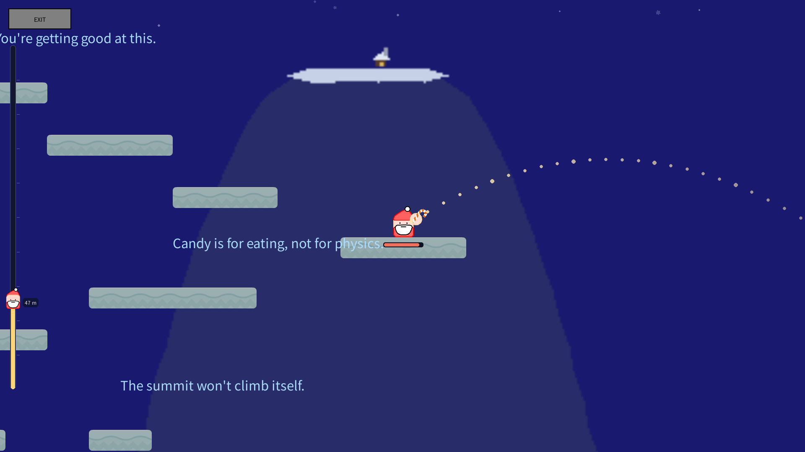
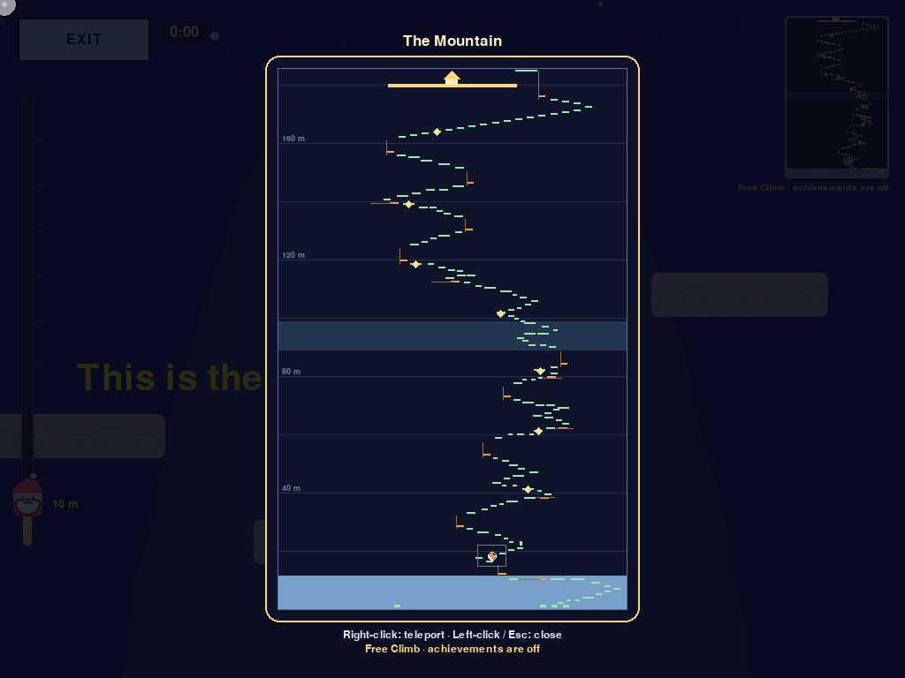

# A SLIPERY CLIMB · SUMMIT — 1.5.1

**A small, slippery climbing game about a Santa who has to get up a very big
mountain to deliver presents. No walk button: throw candy, ride the explosions,
climb.** Desktop · Browser · Android.

### ▶ [Play in your browser](https://hotpot9628.github.io/A-Slipery-Climb/) — no download

The same game now runs in a desktop or mobile browser (WebAssembly build).
Rotate your phone to landscape. On Android you can also install the APK from
this release — it opens full-screen, without a browser address bar.

## What's new in 1.5.1

**Playable in the browser and on Android for the first time.**

- **Browser version** — the whole game runs in Chrome / Edge / Safari on desktop
  and mobile, controls adapted for touch: a left joystick aims and sets throw
  power, a right button throws.
- **Android APK** — installable app that opens the browser build full-screen.
  Small download (~1.5 MB); it loads the game from the web, so it stays on the
  latest version automatically.
- **PWA / add to home screen** — on phones and desktop browsers the page can be
  installed as an app (icon on the home screen / desktop shortcut).
- **Desktop fixes carried by 1.5.1**: the **"Profiles: name"** menu button now
  uses the same font as the other buttons for Latin/Cyrillic names; the bundled
  Chinese/Korean fonts cover far more characters, so no more missing glyphs on
  systems without CJK fonts.
- No gameplay changes: saves, profiles, achievements and Free Climb are
  untouched.

## Download

| Platform | File | Notes |
|---|---|---|
| **Browser** | [Play online](https://hotpot9628.github.io/A-Slipery-Climb/) | nothing to install |
| **Android** | [ASliperyClimb_Android.apk](https://github.com/hotpot9628/A-Slipery-Climb/releases/latest/download/ASliperyClimb_Android.apk) | ~1.5 MB, opens full-screen, needs network |
| **Windows** | [ASliperyClimb_Windows.zip](https://github.com/hotpot9628/A-Slipery-Climb/releases/latest/download/ASliperyClimb_Windows.zip) | unpack, run `A Slipery Climb.exe` |
| **macOS** | [ASliperyClimb_macOS.zip](https://github.com/hotpot9628/A-Slipery-Climb/releases/latest/download/ASliperyClimb_macOS.zip) | unpack, open `A Slipery Climb.app` (Apple Silicon) |
| **Linux** (any) | [ASliperyClimb_Linux.tar.gz](https://github.com/hotpot9628/A-Slipery-Climb/releases/latest/download/ASliperyClimb_Linux.tar.gz) | unpack, run `A Slipery Climb` |
| **Linux** (deb) | [ASliperyClimb_Linux_amd64.deb](https://github.com/hotpot9628/A-Slipery-Climb/releases/latest/download/ASliperyClimb_Linux_amd64.deb) | `sudo apt install ./ASliperyClimb_Linux_amd64.deb` |
| **Linux** (rpm) | [ASliperyClimb_Linux_x86_64.rpm](https://github.com/hotpot9628/A-Slipery-Climb/releases/latest/download/ASliperyClimb_Linux_x86_64.rpm) | `sudo dnf install ./ASliperyClimb_Linux_x86_64.rpm` |

Desktop builds are self-contained: no Python or pygame needed. Verify downloads
with `SHA256SUMS.txt` from this release.

### Browser & Android notes

- Browser saves live in the browser's local storage — clearing site data wipes
  them (the desktop version still saves files under `%APPDATA%` etc.).
- The browser build needs to load the game the first time; after that the
  browser cache makes starts much faster. It is not fully offline.
- Android APK: allow "install unknown apps" when sideloading. It is a Trusted
  Web Activity — content updates automatically with the web version, the app
  shell itself is updated by installing a newer APK.

## Features

- Hand-made level in the spirit of *Getting Over It*: stairs, steep ladders,
  drop jumps, ferries, elevators, curved moving platforms and a windy ridge
- Candy-bomb movement: throw, blast, slide, climb; dotted trajectory preview
- **Easy mode with 8 checkpoints** or the classic normal mode
- **Free Climb** sandbox after the first regular clear: whole-mountain map,
  teleport anywhere
- **Profiles**: several players, each with own saves, achievements and progress
- **Achievements** with levels, run timer, intro / victory cutscenes
- **9 languages**, full voice-over, separate sound / music / voice volume
- **Update prompt** on the desktop build (GitHub Releases only, nothing sent)

## Controls

| Input | Action |
|---|---|
| Mouse | aim and throw candy |
| Left joystick (mobile) | aim direction, distance from centre = throw power |
| Right button (mobile) | throw |
| Alt | toggle the cursor while playing |
| Esc | save and return to the menu |
| Space / Enter | skip cutscene |
| M | open / close the Free Climb map (Free Climb only) |
| Right click on the map | teleport there (Free Climb only) |

## Where the game keeps its data (desktop)

| OS | Folder |
|---|---|
| Windows | `%APPDATA%\A Slipery Climb` |
| macOS | `~/Library/Application Support/A Slipery Climb` |
| Linux | `~/.local/share/A Slipery Climb` |

---

# A SLIPERY CLIMB · SUMMIT — 1.5.1 中文

**一个关于圣诞老人的滑溜溜攀登小游戏：没有“走”键，只能扔糖果、借爆炸反冲往上爬。**
桌面版 · 网页版 · 安卓版。

### ▶ [浏览器直接玩](https://hotpot9628.github.io/A-Slipery-Climb/)——无需下载

同一个游戏现在可以直接在电脑 / 手机浏览器里玩（WebAssembly 版本），手机记得横屏。
安卓还可以安装本页的 APK：打开是全屏、没有地址栏。

## 1.5.1 更新

**首次提供网页版和安卓版。**

- **网页版**：电脑 Chrome / Edge / Safari 和手机浏览器都能玩；手机操作改成触屏——
  左下摇杆控制方向和力度，右下按钮投糖。
- **安卓 APK**：安装后全屏打开网页版，体积只有约 1.5 MB；它从网上加载游戏内容，
  网页版更新后自动生效。
- **可安装为应用（PWA）**：手机「添加到主屏幕」、电脑浏览器可创建桌面快捷方式。
- **桌面版 1.5.1 修复**：主菜单「账号：名字」按钮在名字是拉丁/俄文字母时与其他按钮
  字体一致；内置中文/韩文字体覆盖更多字符，没有系统 CJK 字体的电脑也不会缺字。
- 玩法没有任何改动：存档、账号、成就、自由攀登都不受影响。

## 下载

| 平台 | 文件 | 说明 |
|---|---|---|
| **网页版** | [直接玩](https://hotpot9628.github.io/A-Slipery-Climb/) | 无需安装 |
| **安卓** | [ASliperyClimb_Android.apk](https://github.com/hotpot9628/A-Slipery-Climb/releases/latest/download/ASliperyClimb_Android.apk) | 约 1.5 MB，全屏打开，需联网 |
| **Windows** | [ASliperyClimb_Windows.zip](https://github.com/hotpot9628/A-Slipery-Climb/releases/latest/download/ASliperyClimb_Windows.zip) | 解压，运行 `A Slipery Climb.exe` |
| **macOS** | [ASliperyClimb_macOS.zip](https://github.com/hotpot9628/A-Slipery-Climb/releases/latest/download/ASliperyClimb_macOS.zip) | 解压，打开 `A Slipery Climb.app`（Apple Silicon） |
| **Linux** | [ASliperyClimb_Linux.tar.gz](https://github.com/hotpot9628/A-Slipery-Climb/releases/latest/download/ASliperyClimb_Linux.tar.gz) | 解压运行 |
| **Linux** (deb) | [ASliperyClimb_Linux_amd64.deb](https://github.com/hotpot9628/A-Slipery-Climb/releases/latest/download/ASliperyClimb_Linux_amd64.deb) | `sudo apt install ./ASliperyClimb_Linux_amd64.deb` |
| **Linux** (rpm) | [ASliperyClimb_Linux_x86_64.rpm](https://github.com/hotpot9628/A-Slipery-Climb/releases/latest/download/ASliperyClimb_Linux_x86_64.rpm) | `sudo dnf install ./ASliperyClimb_Linux_x86_64.rpm` |

桌面版自带运行环境，不需要装 Python 或 pygame。可用本页 `SHA256SUMS.txt` 校验下载。

### 网页版 / 安卓版说明

- 网页版存档存在浏览器的本地存储里，清除站点数据会丢失（桌面版仍然存在 `%APPDATA%`
  等目录下的文件里）。
- 网页版第一次打开需要加载游戏内容，之后有缓存会快很多；不能完全离线。
- 安卓 APK 安装时需要允许「未知来源应用」。它是 TWA 应用：游戏内容随网页版自动更新；
  应用外壳（图标、名称等）变更时需要安装新 APK。

## 玩法要点

- 手工关卡（Getting Over It 风格）：台阶、陡梯、下跳、渡船、电梯、弧线移动平台、刮风山脊
- 扔糖果 → 爆炸反冲 → 滑行 / 起跳 / 搭平台，瞄准时显示虚线轨迹
- **简单模式 8 个检查点**，或经典常规模式
- **自由攀登**：常规模式通关一次后解锁，全山地图 + 右键传送
- **多账号**、成就等级、计时器、开场/通关过场
- **9 种语言**全程配音，音效/音乐/语音音量分开调

## 操作

| 操作 | 效果 |
|---|---|
| 鼠标 | 瞄准并投掷糖果 |
| 手机左摇杆 | 控制瞄准方向，推得越远力度越大 |
| 手机右下按钮 | 投掷 |
| Alt | 游戏中切换光标显示 |
| Esc | 保存并返回菜单 |
| 空格 / 回车 | 跳过过场 |
| M | 开/关全山地图（仅自由攀登） |
| 右键点地图 | 传送（仅自由攀登） |

## 存档位置（桌面版）

| 系统 | 目录 |
|---|---|
| Windows | `%APPDATA%\A Slipery Climb` |
| macOS | `~/Library/Application Support/A Slipery Climb` |
| Linux | `~/.local/share/A Slipery Climb` |

---

# A SLIPERY CLIMB · SUMMIT — 1.5.1 Русский

**Маленький «скользкий» платформер про Санту, которому нужно подняться на большую
гору и доставить подарки. Кнопки «идти» нет: только броски конфет и взрывы.**
Компьютер · браузер · Android.

### ▶ [Играть в браузере](https://hotpot9628.github.io/A-Slipery-Climb/) — без загрузки

Та же игра теперь работает прямо в браузере на компьютере и на телефоне
(сборка на WebAssembly); телефон держи горизонтально. Для Android можно
установить APK из этого релиза — открывается на весь экран, без адресной строки.

## Что нового в 1.5.1

**Впервые появились браузерная и Android-версии.**

- **Браузерная версия** — играется в Chrome / Edge / Safari на компьютере и телефоне.
  На телефоне: левый джойстик задаёт направление и силу броска, правая кнопка бросает.
- **Android APK** — приложение открывает браузерную версию на весь экран.
  Весит около 1.5 МБ и подгружает игру из сети, поэтому всегда последняя версия.
- **Установка как приложение (PWA)** — «Добавить на главный экран» на телефоне,
  ярлык на рабочем столе в браузере на компьютере.
- **Исправления десктопной версии 1.5.1**: кнопка **«Профили: имя»** в меню теперь
  использует тот же шрифт, что и остальные кнопки, для латинских и кириллических имён;
  встроенные китайский и корейский шрифты покрывают гораздо больше символов — пропущенных
  глифов на системах без CJK-шрифтов больше нет.
- Геймплей не менялся: сохранения, профили, достижения и «Свободный подъём» те же.

## Загрузка

| Платформа | Файл | Примечание |
|---|---|---|
| **Браузер** | [Играть](https://hotpot9628.github.io/A-Slipery-Climb/) | ничего устанавливать не нужно |
| **Android** | [ASliperyClimb_Android.apk](https://github.com/hotpot9628/A-Slipery-Climb/releases/latest/download/ASliperyClimb_Android.apk) | ~1.5 МБ, на весь экран, нужен интернет |
| **Windows** | [ASliperyClimb_Windows.zip](https://github.com/hotpot9628/A-Slipery-Climb/releases/latest/download/ASliperyClimb_Windows.zip) | распаковать, запустить `A Slipery Climb.exe` |
| **macOS** | [ASliperyClimb_macOS.zip](https://github.com/hotpot9628/A-Slipery-Climb/releases/latest/download/ASliperyClimb_macOS.zip) | распаковать, открыть `A Slipery Climb.app` (Apple Silicon) |
| **Linux** | [ASliperyClimb_Linux.tar.gz](https://github.com/hotpot9628/A-Slipery-Climb/releases/latest/download/ASliperyClimb_Linux.tar.gz) | распаковать и запустить |
| **Linux** (deb) | [ASliperyClimb_Linux_amd64.deb](https://github.com/hotpot9628/A-Slipery-Climb/releases/latest/download/ASliperyClimb_Linux_amd64.deb) | `sudo apt install ./ASliperyClimb_Linux_amd64.deb` |
| **Linux** (rpm) | [ASliperyClimb_Linux_x86_64.rpm](https://github.com/hotpot9628/A-Slipery-Climb/releases/latest/download/ASliperyClimb_Linux_x86_64.rpm) | `sudo dnf install ./ASliperyClimb_Linux_x86_64.rpm` |

Десктопные сборки самодостаточны: Python и pygame не нужны. Проверка загрузки —
`SHA256SUMS.txt` из этого релиза.

### Браузер и Android

- Сохранения браузерной версии хранятся в локальном хранилище браузера: очистка данных
  сайта их удалит (десктопная версия по-прежнему пишет файлы в `%APPDATA%` и т. п.).
- Браузерной версии нужно один раз загрузить игру из сети; дальше кэш ускоряет запуск.
  Полностью офлайн она не работает.
- APK: при установке разрешите «неизвестные источники». Это TWA-приложение: контент
  обновляется вместе с браузерной версией, а оболочку (иконка, название) обновляют
  установкой нового APK.

## Возможности

- Ручной уровень в духе Getting Over It: лестницы, прыжки вниз, паромы, лифты, ветреный гребень
- Движение бросками конфет: бросок → взрыв → скольжение / прыжок; пунктирная траектория
- **Лёгкий режим с 8 контрольными точками** или классический обычный режим
- **Свободный подъём** после первого прохождения: карта всей горы и телепорт правым кликом
- **Профили**, достижения с уровнями, таймер забега, катсцены
- **9 языков**, полная озвучка, отдельные громкости звука/музыки/голоса

## Управление

| Ввод | Действие |
|---|---|
| Мышь | прицеливание и бросок конфеты |
| Левый джойстик (телефон) | направление прицела, дальше от центра — сильнее бросок |
| Правая кнопка (телефон) | бросок |
| Alt | переключить курсор в игре |
| Esc | сохранить и выйти в меню |
| Пробел / Enter | пропустить катсцену |
| M | карта горы (только «Свободный подъём») |
| Правый клик по карте | телепорт (только «Свободный подъём») |

## Где хранятся данные (десктоп)

| ОС | Папка |
|---|---|
| Windows | `%APPDATA%\A Slipery Climb` |
| macOS | `~/Library/Application Support/A Slipery Climb` |
| Linux | `~/.local/share/A Slipery Climb` |

---

*Made with Python 3.8 + pygame. Browser build compiled with pygbag (Python on
WebAssembly). Music, sounds and voice clips are part of the game; see
THIRD-PARTY-NOTICES.txt in the repository for licenses.*
